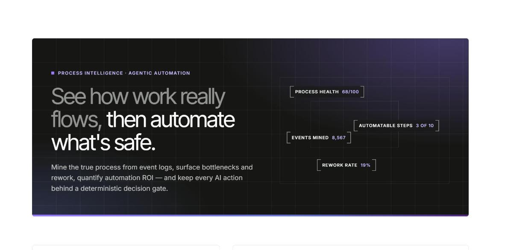
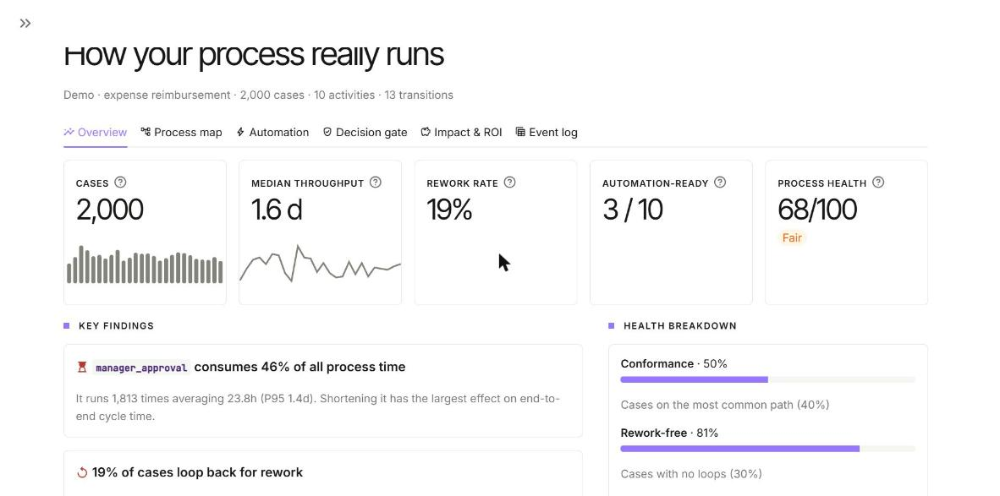
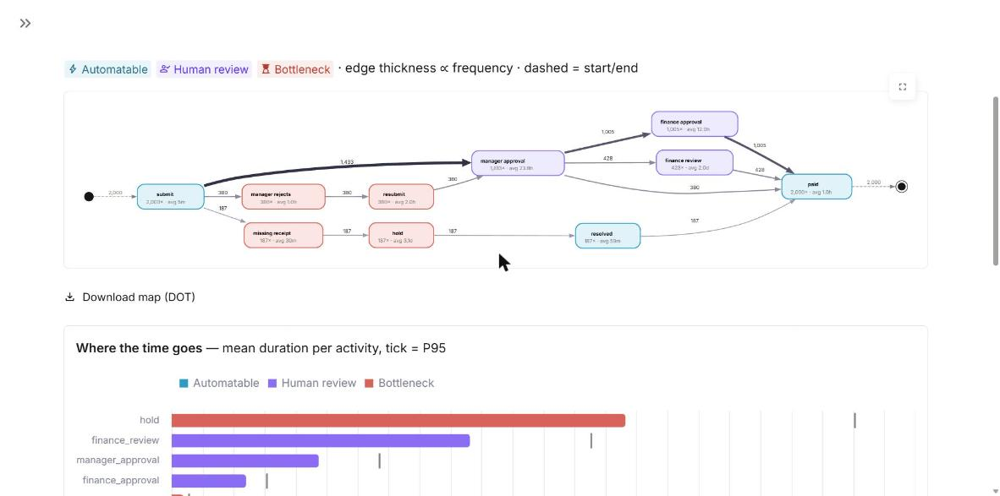
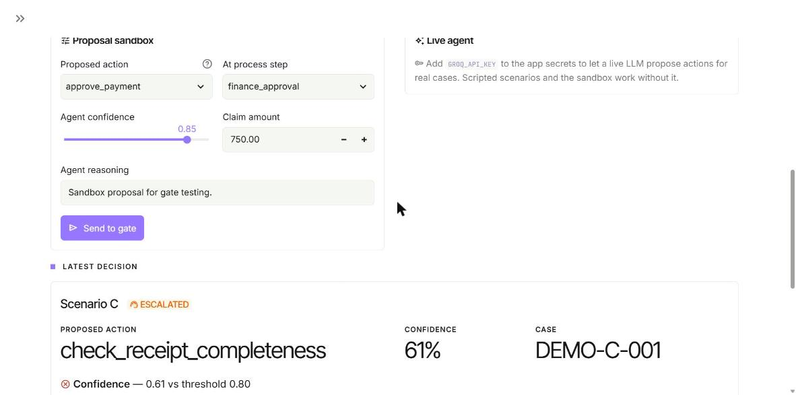

# Process Intelligence + Agentic Automation Engine

> Mine how work **really** flows from raw event logs, pinpoint bottlenecks and rework,
> quantify automation ROI — and keep every AI-proposed action behind a deterministic
> decision gate with a full audit trail.

[](https://automationprocess-mining-axwvl7ifpjurzdcrn8ayzy.streamlit.app/)
[](https://github.com/t20071/automation_process-mining/actions/workflows/ci.yml)
[](https://www.python.org/downloads/)
[](LICENSE)

### 🔗 Live demo → **https://automationprocess-mining-axwvl7ifpjurzdcrn8ayzy.streamlit.app/**

No sign-up or API key needed — click **Analyse demo dataset** to explore 2,000 synthetic
expense-reimbursement cases, or upload your own CSV.



---

## Contents

- [What it does](#what-it-does)
- [Screenshots](#screenshots)
- [How it works](#how-it-works)
- [Repository structure](#repository-structure)
- [Quick start](#quick-start)
- [Using your own data](#using-your-own-data)
- [Configuration](#configuration)
- [Testing & quality](#testing--quality)
- [Deployment](#deployment)
- [Known limitations](#known-limitations)

---

## What it does

| Capability | Details |
|---|---|
| **Process discovery** | Builds a Directly-Follows Graph from any event log: every path, loop and hand-off, with case frequencies and mean waiting times. Interactive, zoomable, filterable. |
| **Process diagnostics** | Cycle time, P95 and variability per activity; case throughput; rework detection; path (variant) analysis; a 0–100 **process health score**. |
| **Key findings** | Plain-language insights generated from the data — biggest time sink, rework cost, least predictable step, slowest path, value-based differences. |
| **Automation advisor** | Classifies each activity as *Automatable*, *Human review* or *Bottleneck*, explains why, and recommends how (tools, approach, expected saving). Optional Groq LLM enrichment. |
| **Impact & ROI** | Adjustable assumptions (currency, hourly cost, handling time, adoption, scope) → annualised labour saving, hours freed, cases touched, cycle-time impact. |
| **Governed agent actions** | The LLM only *proposes*. A deterministic gate checks confidence, policy allowlist and impact, then approves, denies or escalates — logged to an append-only audit trail. Includes scripted scenarios, a proposal sandbox and a live agent. |

## Screenshots

| Overview | Process map |
|---|---|
|  |  |

| Decision gate |
|---|
|  |

## How it works

```mermaid
flowchart LR
    A[Event log CSV] --> B[Ingestion<br/>auto-map columns]
    B --> C[Process mining<br/>DFG + statistics]
    C --> D[Analytics<br/>health · insights · ROI]
    C --> E[Automation advisor<br/>rules + optional LLM]
    E --> F[Agent proposes<br/>JSON action]
    F --> G{Decision gate}
    G -->|confidence low| H[ESCALATED]
    G -->|not allowlisted| I[DENIED]
    G -->|high impact| H
    G -->|all pass| J[APPROVED]
    G --> K[(Audit log)]
```



**The non-negotiable rule:** the LLM never executes anything. It emits a
schema-validated `ActionProposal`; `GateEngine` evaluates three ordered gates and
records every decision. See [docs/architecture.md](docs/architecture.md) for module
responsibilities, classification logic and caching.

## Repository structure

```
automation_process-mining/
├── app.py                         # Streamlit entry point (thin — no business logic)
├── src/process_agent/             # Installable Python package
│   ├── config.py                  #   Settings: st.secrets → env vars → defaults
│   ├── logging_config.py          #   Structured JSON logging
│   ├── ingestion/                 #   Load & clean event logs
│   │   └── event_log.py           #     column auto-detection, validation, duration derivation
│   ├── generators/                #   Synthetic data
│   │   └── log_generator.py       #     expense-reimbursement logs, 4 process variants
│   ├── mining/                    #   Process intelligence (pure pandas / networkx)
│   │   ├── process_mining.py      #     Directly-Follows Graph, activity stats, bottlenecks
│   │   ├── analytics.py           #     cases, paths, health score, insights, ROI
│   │   └── automation_advisor.py  #     automatable / review / bottleneck + how-to
│   ├── agent/                     #   Governed AI actions
│   │   ├── llm_client.py          #     ActionProposal schema, Groq & deterministic providers
│   │   └── gate_engine.py         #     confidence / policy / impact gates, audit log
│   └── ui/                        #   Streamlit presentation layer
│       ├── state.py               #     session state & data-loading callbacks
│       ├── analysis.py            #     cached per-dataset analysis bundle
│       ├── workspace.py           #     sidebar + tab layout
│       ├── components/            #     reusable building blocks
│       │   ├── theme.py           #       design tokens, hero, eyebrow, stat blocks
│       │   └── charts.py          #       process-map DOT builder, Altair charts
│       └── views/                 #     one module per screen
│           ├── landing.py         #       hero, demo / upload entry points
│           ├── overview.py        #       KPIs, health, key findings, trends, paths
│           ├── process_map.py     #       interactive DFG, time analysis
│           ├── automation.py      #       per-activity advice cards
│           ├── decision_gate.py   #       scenarios, sandbox, live agent, audit log
│           ├── roi.py             #       assumptions → annualised impact
│           └── event_log.py       #       data quality, filters, export
├── tests/
│   ├── conftest.py                # shared fixtures
│   ├── unit/                      # one file per module (no network, no Streamlit server)
│   └── integration/               # end-to-end: generate → mine → propose → gate
├── data/
│   ├── event_logs.csv             # sample synthetic log (2,000 cases)
│   └── README.md                  # input schema & column aliases
├── docs/
│   ├── architecture.md            # design principles, data flow, module map
│   ├── design-system.md           # colours, fonts, components, chart rules
│   ├── deployment.md              # Streamlit Cloud, secrets, update workflow
│   ├── images/                    # README screenshots
│   └── plans/                     # original implementation plan & task list
├── .github/workflows/ci.yml       # lint + tests on every push / PR
├── .streamlit/
│   ├── config.toml                # theme (colours, fonts, radius) — no secrets
│   └── secrets.toml.example       # template for local / cloud secrets
├── pyproject.toml                 # package metadata, deps, ruff / black / pytest config
├── requirements.txt               # runtime deps for Streamlit Cloud
├── Makefile                       # setup / run / test / lint / format / data
├── .env.example                   # local environment variables template
├── CHANGELOG.md                   # release notes
├── CLAUDE.md                      # guidance for AI coding assistants
└── LICENSE                        # MIT
```

Runtime-only folders (gitignored): `audit/` (decision log), `.venv/` or `venv/`.

## Quick start

```bash
git clone https://github.com/t20071/automation_process-mining.git
cd automation_process-mining

python -m venv .venv
# Windows: .venv\Scripts\activate    macOS/Linux: source .venv/bin/activate
pip install -e ".[dev]"

streamlit run app.py          # → http://localhost:8501
```

Prefer conda? `make setup && make run` creates `./venv` with Python 3.11.

## Using your own data

Upload a CSV with at least **case ID, activity and timestamp** columns. Names are
auto-detected (`Case ID`, `Task`, `Start Time`, `Elapsed`, `Resource`, …). If there is
no duration column, durations are derived from the time to the next event in the case.
See [data/README.md](data/README.md) for the full schema, or download the sample CSV
from the app.

## Configuration

All settings are optional. Locally use `.env` (copy `.env.example`); on Streamlit Cloud
use **App settings → Secrets** (copy `.streamlit/secrets.toml.example`).

| Variable | Default | Purpose |
|---|---|---|
| `GROQ_API_KEY` | — | Enables LLM-enhanced advice and the live agent |
| `LLM_PROVIDER` | `groq` if a key exists, else `deterministic` | Force a provider |
| `GROQ_MODEL` | `llama-3.3-70b-versatile` | Groq model |
| `CONFIDENCE_THRESHOLD` | `0.80` | Minimum confidence for auto-approval |

In-app, the sidebar lets you tune how many bottlenecks to flag and the consistency
(coefficient-of-variation) threshold for automatable steps.

## Testing & quality

```bash
pytest                         # 80 tests — deterministic provider, no network calls
ruff check src tests app.py    # lint
```

CI runs both on Python 3.11 and 3.12 for every push and pull request.

## Deployment

The live app redeploys automatically on every push to `main`:

```bash
git add -A && git commit -m "your message" && git push origin main
```

Repository, branch (`main`) and main file (`app.py`) are unchanged, so the live URL
stays the same. Details and secrets setup: [docs/deployment.md](docs/deployment.md).

## Known limitations

- **Synthetic demo data.** The bundled log is generated; real logs will be noisier.
- **Prototype thresholds.** Bottleneck count, CV threshold, gate threshold and ROI
  assumptions are sensible defaults, not calibrated values — tune them per process.
- **Heuristic classification.** Activity semantics come from keyword rules (optionally
  enriched by an LLM); review the advice before acting on it.
- **ROI is an estimate.** Linear annualisation from the log period; validate with a pilot.
- **Ephemeral audit log on Streamlit Cloud.** It resets on reboot — download it from the
  Decision gate tab if you need to keep it.
- **No production security hardening.** No authentication, multi-tenancy or durable storage.

## License

[MIT](LICENSE)
