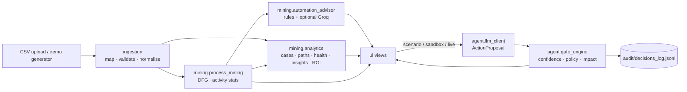

# Architecture

## Design principles

1. **The LLM never executes anything.** Agents emit a schema-validated `ActionProposal`;
   a deterministic `GateEngine` decides and writes every decision to an append-only
   audit log. No code path lets a proposal bypass the gate.
2. **Layered, one-directional dependencies.** `ui` → `mining` / `agent` → `ingestion` /
   `generators`. Nothing below `ui` imports Streamlit (except `config`, which reads
   `st.secrets` defensively), so every domain module is testable in isolation.
3. **Deterministic by default.** Analytics, insights and ROI are pure pandas. The LLM
   only *enriches* advice and *proposes* actions; with no API key the whole app still
   works through the deterministic provider.
4. **Deployable anywhere.** No native binaries: the process map is DOT rendered
   client-side, charts are Vega-Lite, storage is local files.

## Data flow

## Modules

| Module | Responsibility | Key API |
|---|---|---|
| `ingestion/event_log.py` | Column auto-detection, validation, cleaning, duration derivation | `normalise_event_log(raw) -> IngestResult` |
| `generators/log_generator.py` | Synthetic expense-reimbursement logs (4 variants) | `generate_event_log(num_cases, seed)` |
| `mining/process_mining.py` | Directly-Follows Graph, per-activity stats, bottleneck & consistency flags | `discover_process_map(df, bottleneck_top_n, cv_threshold)` |
| `mining/analytics.py` | Case table, path variants, weekly trend, health score, insights, ROI | `case_table`, `health_score`, `generate_insights`, `estimate_roi` |
| `mining/automation_advisor.py` | Classify each activity (automatable / review / bottleneck) and explain how to automate it | `get_automation_advice(pm, groq_api_key)` |
| `agent/llm_client.py` | `ActionProposal` schema; Groq and deterministic providers; tolerant JSON parsing | `get_client(provider, ...)` |
| `agent/gate_engine.py` | Three ordered gates, audit logging, side-effect-free `trace()` | `GateEngine.evaluate`, `GateEngine.trace` |
| `config.py` | Settings from `st.secrets` → env → defaults | `get_settings()` |
| `ui/analysis.py` | Per-dataset cached bundle consumed by all views | `analyse(df, settings) -> Analysis` |
| `ui/workspace.py` | Sidebar + tab layout | `render_workspace(settings)` |
| `ui/views/*` | One module per screen | `render_*_tab(...)` |
| `ui/components/*` | Design tokens, HTML helpers, chart builders | `build_dot`, `*_chart`, `hero`, `eyebrow` |

## Classification logic

An activity is classified in this order:

1. Name matches an approval / review keyword → **Human review** (workflow tooling only).
2. Name matches an exception keyword, or it is a top-N variance step → **Bottleneck**
   (fix upstream, don't automate the symptom).
3. Coefficient of variation ≤ threshold (default 0.30) → **Automatable**, with a
   keyword-matched implementation blueprint.
4. Otherwise → **Review recommended** (pilot first).

## Gate order

| # | Gate | Fails when | Outcome |
|---|---|---|---|
| 1 | Confidence | `confidence < threshold` | `ESCALATED` |
| 2 | Policy allowlist | action not allowlisted | `DENIED` |
| 3 | High-impact | action is high-impact | `ESCALATED` |
| — | All pass | — | `APPROVED` |

## Caching

`ui/analysis.py` caches on a UUID minted each time a dataset is loaded, not on a hash
of the DataFrame. Reruns stay fast on large uploads, and a new upload can never be
served a previous file's results.
